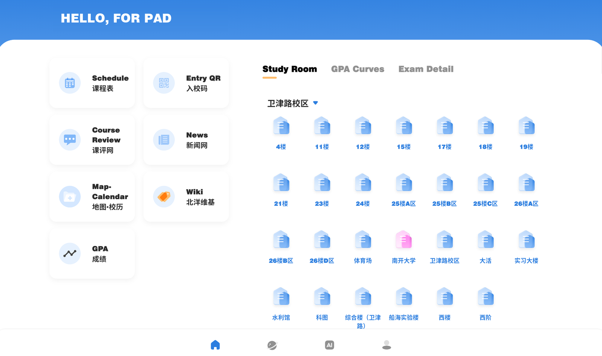
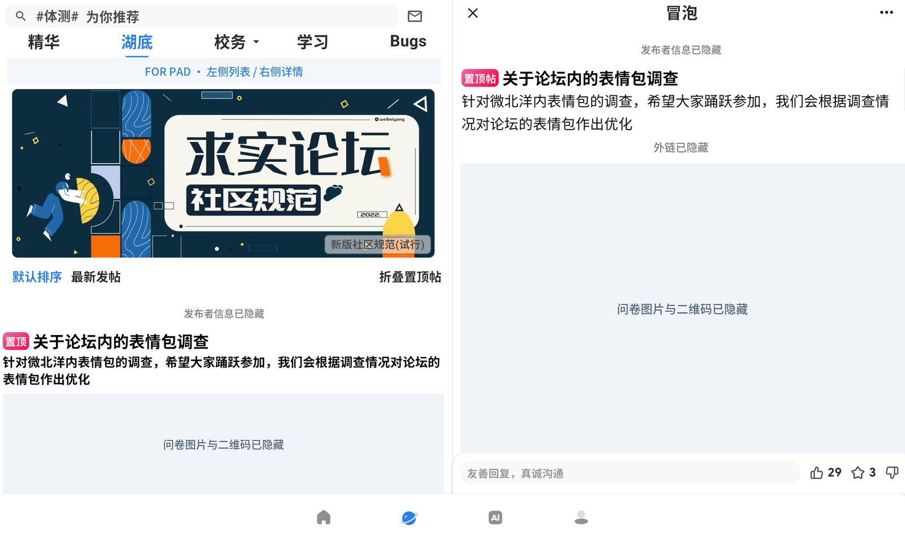
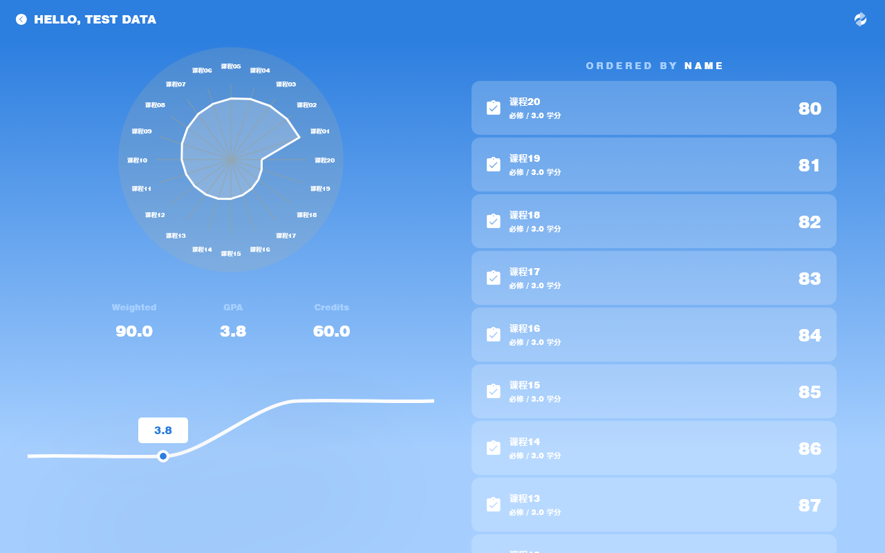

# 微北洋 For Pad

这是基于 [twtstudio/WePeiYang-Flutter](https://github.com/twtstudio/WePeiYang-Flutter) 的**非官方平板适配 fork**。保留微北洋的校园服务，重点改进横屏双栏、阅读宽度、课表周切换和窗口尺寸变化时的布局。

**[下载本 fork 最新版](https://github.com/huaaaajjj/WePeiYang-Flutter/releases/latest)** · [反馈平板适配问题](https://github.com/huaaaajjj/WePeiYang-Flutter/issues) · [原项目与致谢](#原项目与致谢)

## 本 fork 改了什么

本 fork 主要针对 Android 平板横屏和大窗口优化布局：首页将两列工具卡与自习室、GPA、考试信息分置左右，并限制内容宽度；海棠支持左侧浏览与搜索、右侧查看帖子，返回时逐层收起详情和搜索；课程表将周选择器移至左侧纵向排列，保留收起前的滚动位置；GPA 将图表与成绩分栏展示，两栏独立滚动，并保留学期选择、排序和指标切换。自习室网格根据可用宽度排列，兼顾不同校区的楼栋数量，阅读页面、表单、设置和弹窗也调整了宽度与网格布局。窗口旋转、分屏或调整大小时会重新计算尺寸，减少缩放异常与内容溢出。平板布局仅在窗口最短边至少 600dp 且处于横屏时启用，手机、平板竖屏及更窄的窗口沿用单栏布局，平板竖屏仍限制字号缩放，避免文字过大。启动方向判断使用真实显示屏尺寸，避免平板横屏启动或恢复前台时被错误锁成竖屏；手机仍保留竖屏限制。

## 界面预览

### 海棠双栏阅读

左侧列表不离场，右侧打开帖子；无需反复跳转整页再找回列表位置。

### GPA 双栏

成绩使用**模拟测试数据**，不包含任何人的真实成绩、课程或学号。

> 截图说明：首页、海棠、地图·校历来自平板实机；GPA 由真实页面组件配合模拟数据渲染。截图已裁去系统状态栏并去除元数据；问候昵称、发布者信息、帖子编号、外链和二维码使用不透明覆盖或占位文字替换。为避免暴露个人安排，不展示真实课表。截图中的脱敏标记不是应用功能。

## 下载与安装

前往 **[本仓库 Releases](https://github.com/huaaaajjj/WePeiYang-Flutter/releases/latest)**，下载附件中的 APK。

| 项目 | 本次发行 |
| --- | --- |
| 发布标签 | `v4.6.4-pad.5` |
| 应用版本 | `4.6.4+201`，基于上游 `4.6.4` |
| 应用名称 | 微北洋 For Pad |
| 独立包名 | `com.twt.service.pad` |

- 可以与官方微北洋包并存，**不覆盖、不清除它们的数据**。
- 独立包名意味着首次安装需要重新登录；此前测试包的数据不会自动迁移。
- 本版沿用现有 Android Debug 测试签名，不代表上游官方发行签名；后续版本需保持包名与签名一致才能覆盖升级。仅从本仓库下载并核对发行页提供的 SHA-256。
- universal APK 包含 ARMv7、ARM64 和 x86_64 的 Flutter 引擎，支持对应设备及模拟器。
- 本 fork 会在启动时检查本仓库的正式 Release，发现新版后提示下载，校验通过再交给 Android 确认安装；支持跳过版本和失败重试，不使用上游 APK 或热更新。旧 `pad.2` 需要先手动升级到本版，之后才具备自动检查能力。

## 适配范围与已知限制

- 主要实测设备为 **Lenovo TB710FU**，横屏 **1280×800dp**；这不是对所有 Android 平板的兼容性保证。
- 方向修复已在 API 31 / API 32 模拟器完成前后对照；**尚未验证 HUAWEI MatePad Air / HarmonyOS 真机**。
- 手机与平板竖屏尽量保持原有布局；本 fork 的重点是 Android 平板，未针对 iOS、桌面端重新验收。
- 平板首页的工具网格不提供长按拖拽，排序请到「我的 → 工具栏管理」。
- 校园服务、登录和数据仍依赖上游服务；本 fork 不提供独立后端或绕过账号绑定。
- 独立包名不具备上游全部第三方服务配置：**当前原生定位接口不支持此包名**，厂商推送等能力未重新认证；内置校园地图图片浏览不受此定位限制影响。
- 首页可选的内嵌地图·校历区仍待单独实机补验；失物招领未开放入口的页面不宣称已验收。
- 静态检查保留已有的 **27 warning、2 info、0 error**；未通过关闭分析规则掩盖诊断。

## 原项目与致谢

平板版建立在天外天工作室与上游贡献者的工作之上。校园服务、原有功能与大部分代码来自上游；本 fork 主要维护平板布局及独立发行相关调整。**本仓库不代表上游，平板适配问题请先在本 fork 反馈。**

保留的原 README：项目介绍、功能与资源

> 微北洋是由天津大学天外天工作室（移动组）开发运维的校园 APP，面向天津大学全体师生，集课表、自习室、校园公告、GPA、失物招领等功能于一体。

原项目功能包括课程表、地图校历、北洋 Wiki 入口、GPA 查询、青年湖底、自习室、考试信息、失物招领和小天 AI；实际可用性以对应版本及服务为准。

- [上游 Flutter 仓库](https://github.com/twtstudio/WePeiYang-Flutter)
- [原 README 完整版本（上游 4.6.4）](https://github.com/twtstudio/WePeiYang-Flutter/blob/df053d64/README.md)
- [官方微北洋主页与下载（需要校园网）](https://mobile.twt.edu.cn/wpy/index.html) — **这里下载的不是本 fork 平板版**
- [早期 Android 客户端](https://github.com/twtstudio/WePeiYang-Android)
- [早期 iOS 客户端](https://github.com/twtstudio/WePeiYang-iOS-Everest)
- [原项目运行问题汇总](https://www.cnblogs.com/ZzTzZ/p/17344002.html)

Copyright (C) 天津大学天外天工作室（移动组）。

## 许可证

沿用 [GPL-3.0-or-later](LICENSE)。分发修改后的版本时须遵守许可证并提供相应源代码；本软件按原样提供，不附带任何担保。原项目名称、标识和第三方内容归各自权利人所有。
